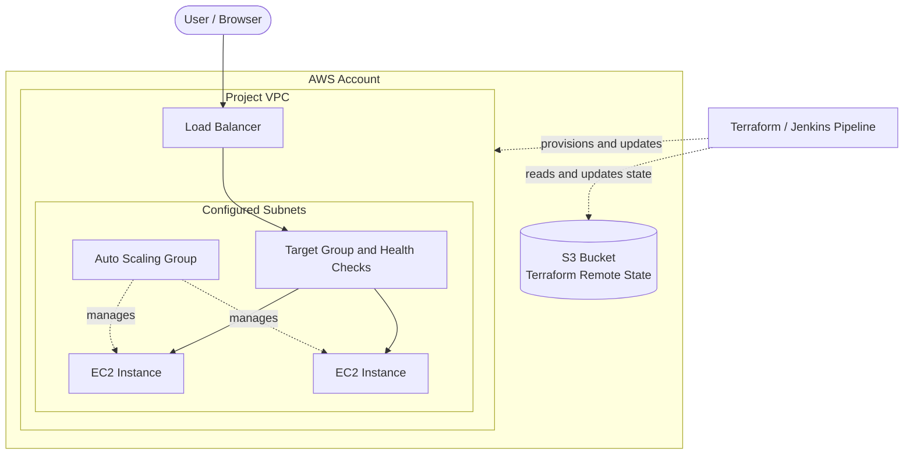
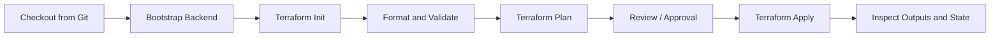

<div align="center">

# AWS Infrastructure Automation with Terraform & Jenkins

**A modular AWS infrastructure project provisioned as Infrastructure as Code (IaC).**

[](https://developer.hashicorp.com/terraform)
[](https://aws.amazon.com/)
[](https://www.jenkins.io/)

[Architecture](#-architecture) · [Repository Structure](#-repository-structure) · [How It Works](#-how-the-infrastructure-works) · [Deploy](#-deployment-guide) · [Cleanup](#-clean-up-resources)

</div>

---

## 📌 Project Overview

This project uses **Terraform** to define and provision AWS infrastructure through reusable configuration rather than creating each resource manually in the AWS Console.

The infrastructure includes:

- **Amazon VPC** — a logically isolated network for the project.
- **Subnets** — divide the VPC network and place resources in appropriate network segments.
- **Amazon EC2** — compute instances that run the workload.
- **Auto Scaling Group (ASG)** — maintains the desired number of EC2 instances and can replace unhealthy instances or scale capacity according to its configuration.
- **Load Balancer** — provides a common entry point and distributes incoming traffic to registered targets.
- **Amazon S3 remote backend** — stores Terraform state remotely so the infrastructure can be managed consistently.
- **Jenkins pipeline** — automates Terraform commands such as initialization, validation, planning, and applying changes.

> **Scope note:** The S3 bucket used for Terraform state is the *backend*. It is different from an S3 bucket that might be used to host application files or static website content.

## 🧭 Table of Contents

<details open>
<summary><strong>Click to expand or collapse</strong></summary>

- [Project Overview](#-project-overview)
- [Architecture](#-architecture)
- [Repository Structure](#-repository-structure)
- [AWS Components Explained](#-aws-components-explained)
- [How the Infrastructure Works](#-how-the-infrastructure-works)
- [Prerequisites](#-prerequisites)
- [Deployment Guide](#-deployment-guide)
- [Jenkins Pipeline](#-jenkins-pipeline)
- [Verification Checklist](#-verification-checklist)
- [Security and Cost Notes](#-security-and-cost-notes)
- [Clean Up Resources](#-clean-up-resources)
- [Troubleshooting](#-troubleshooting)
- [Learning Outcomes](#-learning-outcomes)

</details>

## 🏗️ Architecture



<details>
<summary><strong>How to read this diagram</strong></summary>

1. A user sends a request to the load balancer.
2. The load balancer forwards requests to healthy registered targets.
3. The Auto Scaling Group manages the EC2 capacity according to its minimum, desired, maximum, and scaling configuration.
4. The VPC and subnet configuration provide the network boundaries for the resources.
5. Terraform uses the S3 backend to store and retrieve its state during infrastructure operations.
6. Jenkins can run the Terraform workflow automatically or on demand, depending on the job and trigger configuration.

</details>

> **Important:** The diagram is a conceptual overview. The exact subnet placement, number of Availability Zones, listener protocol, scaling policies, and security-group rules depend on the Terraform configuration in this repository.

## 📁 Repository Structure

The repository separates the **backend bootstrap** from the main infrastructure configuration. The tree below is a guide to the project layout; check the actual files in the repository if filenames have changed.

```text
capstone-terraform/
├── backend/                  # Creates the S3 bucket for Terraform state
│   └── *.tf                  # Backend bootstrap Terraform configuration
├── capstone/                 # Main AWS infrastructure configuration
│   ├── *.tf                  # Provider, variables, outputs and resource wiring
│   └── modules/
│       ├── vpc/              # VPC and subnet/network resources
│       ├── ec2/              # EC2-related configuration
│       └── nginx/             # Web-server/application setup, if used
├── Jenkinsfile               # Jenkins pipeline definition, if stored here
└── README.md                 # Project documentation
```

### Why keep `backend/` separate?

Terraform needs its state backend to exist before it can use that backend. The bootstrap configuration can create the S3 bucket first, using local state or another deliberate bootstrap method. The main configuration can then initialize against the S3 backend.

**Keep the backend lifecycle separate:** avoid configuring the main infrastructure pipeline to destroy the S3 bucket that contains its own state.

## 🧩 AWS Components Explained

<details open>
<summary><strong>1. VPC and Subnets — the network foundation</strong></summary>

The **Virtual Private Cloud (VPC)** is the project's isolated AWS network. Subnets divide the VPC's IP address range and allow resources to be placed in different Availability Zones or network tiers.

Typical design considerations:

- Choose a VPC CIDR range that does not overlap with connected networks.
- Use public subnets for resources that need direct internet-facing access, such as an internet-facing load balancer.
- Place application instances in the subnet tier appropriate to the actual routing and security design.
- Configure route tables, an Internet Gateway, and NAT resources if required by the design.
- Restrict access with security groups instead of opening ports broadly.

</details>

<details>
<summary><strong>2. EC2 — compute capacity</strong></summary>

Amazon EC2 provides virtual servers for running the project workload. Instance settings may include the AMI, instance type, key pair, security groups, and user-data/bootstrap commands.

When EC2 instances are managed by an Auto Scaling Group, the group—not a manually created standalone instance—should normally be treated as the owner of instance capacity.

</details>

<details>
<summary><strong>3. Auto Scaling Group — managed capacity</strong></summary>

The **ASG** maintains the configured desired capacity and can launch or terminate instances within its minimum and maximum limits. Depending on the configuration, it may also replace unhealthy instances and scale in or out in response to policies or metrics.

Check the Terraform configuration for the actual desired/minimum/maximum capacity, health-check settings, launch template, and scaling policies. An ASG does not necessarily scale based on CPU unless a suitable policy is configured.

</details>

<details>
<summary><strong>4. Load Balancer — traffic distribution</strong></summary>

The load balancer gives clients a common endpoint and routes requests to registered targets. For an Application Load Balancer, the listener receives requests and forwards them to a target group. Health checks help identify targets that should receive traffic.

If the load balancer reports unhealthy targets, verify target-group health-check paths and ports, instance security-group rules, application service status, and subnet/network routing.

</details>

<details>
<summary><strong>5. Amazon S3 — Terraform remote state</strong></summary>

Terraform state maps the configuration to real infrastructure. An S3 backend allows the state file to be stored remotely rather than only on a developer's computer.

Benefits include:

- A shared state location for authorized team members and automation.
- Better continuity when a local workspace or Jenkins agent changes.
- A clear separation between backend bootstrap and the resources managed by the main configuration.

Use a unique bucket name, block public access, enable encryption, and tightly restrict IAM permissions. Consider versioning and the state-locking mechanism supported by your Terraform/backend setup. Do not commit credentials or state files containing sensitive values to Git.

</details>

## 🔄 How the Infrastructure Works

<list>
  <list-item>**1 — Bootstrap the backend:** Terraform in `backend/` creates the S3 state bucket. This step must happen before the main configuration can use that bucket.</list-item>
  <list-item>**2 — Initialize the main configuration:** run `terraform init` from the main Terraform directory so Terraform installs providers and configures the remote backend.</list-item>
  <list-item>**3 — Validate the configuration:** run formatting and validation checks to catch syntax and configuration issues.</list-item>
  <list-item>**4 — Review the plan:** `terraform plan` shows the proposed infrastructure changes before they are applied.</list-item>
  <list-item>**5 — Apply the plan:** `terraform apply` provisions or updates the resources described by the configuration.</list-item>
  <list-item>**6 — Route traffic:** the load balancer forwards requests to healthy registered targets while the ASG manages EC2 capacity.</list-item>
  <list-item>**7 — Track state remotely:** Terraform reads and updates state in S3 as it manages the infrastructure.</list-item>
</list>

## 🛠️ Prerequisites

Before deploying, ensure you have:

- [ ] An AWS account and a region selected for the deployment.
- [ ] Terraform installed on the machine or Jenkins agent.
- [ ] AWS credentials configured securely for the identity running Terraform.
- [ ] IAM permissions for the resources Terraform needs to create, read, update, and delete.
- [ ] Git installed and the repository cloned.
- [ ] The backend S3 bucket created before initializing the main configuration against it.
- [ ] Jenkins configured with the required tools and credentials if using the pipeline.

**Never paste AWS access keys into Terraform files, the Jenkinsfile, or this README.** Use Jenkins Credentials, an AWS role, or another approved credential mechanism.

## 🚀 Deployment Guide

### 1. Clone the repository

```bash
git clone https://github.com/Armaan-2005/capstone-terraform.git
cd capstone-terraform
```

### 2. Create the remote-state backend

```bash
cd backend
terraform init
terraform fmt -check
terraform validate
terraform plan
terraform apply
```

Review the plan before applying. These commands assume the `backend/` directory contains a standalone bootstrap configuration and that AWS credentials are configured.

### 3. Initialize the main infrastructure

Return to the repository root and enter the directory containing the main Terraform configuration:

```bash
cd ../capstone
terraform init
terraform fmt -check
terraform validate
terraform plan
```

If the backend is configured in the Terraform files, verify its bucket, key, and region match the backend you created. If the repository uses a different directory or backend initialization arguments, adjust the commands accordingly.

### 4. Apply the infrastructure

```bash
terraform apply
```

Inspect the plan and confirm the proposed changes before approving. Use `-auto-approve` only in a controlled automation workflow where the plan and approval process are understood.

### 5. Inspect outputs and resources

```bash
terraform output
terraform state list
```

Use the AWS Console to verify the VPC, subnet associations, EC2 instances, Auto Scaling Group, load balancer, and target-group health.

## 🤖 Jenkins Pipeline

The repository's Jenkins workflow can automate Terraform execution. The intended flow is:



A pipeline may use Windows `bat` commands when Jenkins runs on Windows, or shell steps such as `sh` on Linux agents. The exact commands must match the Jenkins agent operating system and the repository's directory layout.

**Pipeline safety reminders**

- Store AWS credentials in Jenkins Credentials and reference them by credential ID.
- Ensure the pipeline runs Terraform from the correct directory.
- Bootstrap the backend before the main Terraform `init`.
- Keep plan and apply stages consistent; where possible, apply the reviewed saved plan.
- Restrict who can run apply or destroy operations.
- Do not automatically destroy the backend bucket as part of the main infrastructure cleanup.

## ✅ Verification Checklist

Use this checklist after deployment:

- [ ] The VPC exists with the expected CIDR range.
- [ ] The subnets exist in the intended Availability Zones.
- [ ] Route tables and gateways match the intended network design.
- [ ] Security groups permit only the required traffic.
- [ ] The Auto Scaling Group reports the expected desired capacity.
- [ ] EC2 instances are healthy and have completed their bootstrap steps.
- [ ] The load balancer is active and its target group reports healthy targets.
- [ ] The application responds at the load balancer DNS name, if an application is configured.
- [ ] Terraform state is stored in the intended S3 bucket and key.
- [ ] The Jenkins build completes successfully and does not expose secrets in logs.

## 🔐 Security and Cost Notes

- Keep S3 Block Public Access enabled for the Terraform state bucket.
- Use least-privilege IAM permissions for Terraform and Jenkins.
- Avoid allowing SSH (`22`) or application ports from `0.0.0.0/0` unless there is a deliberate, justified requirement.
- Prefer allowing application traffic from the load balancer's security group to the EC2 security group.
- Review whether instances should be in public or private subnets; the correct answer depends on routing and access requirements.
- EC2 instances, load balancers, NAT Gateways, and other resources can incur charges while running.
- Check the AWS Billing console after testing and remove resources you no longer need.

## 🧹 Clean Up Resources

Destroy only the resources you intend to remove. From the **main infrastructure directory**:

```bash
terraform plan -destroy
terraform destroy
```

Review the proposed deletions carefully. Keep the S3 backend bucket until the main infrastructure has been destroyed and you are certain its state is no longer needed. If you decide to remove the backend bucket too, do it as a separate, deliberate step after confirming that no Terraform state or other important objects remain in it.

## 🧯 Troubleshooting

<details>
<summary><strong>Terraform says the S3 backend bucket does not exist</strong></summary>

Run the backend bootstrap configuration first. Then verify the bucket name, region, and backend key in the main configuration. Re-run `terraform init` from the main directory after correcting backend settings.
</details>

<details>
<summary><strong>Terraform reports that no valid AWS credentials were found</strong></summary>

Check the identity and credential configuration available to the same terminal or Jenkins agent that runs Terraform. For Jenkins, verify the credential ID and binding, and confirm that the AWS provider can access the credentials. Do not print secret values to the build log.
</details>

<details>
<summary><strong>Load balancer targets are unhealthy</strong></summary>

Confirm that the application is running and listening on the configured port, that the health-check path returns the expected status, and that the instance security group allows traffic from the load balancer security group. Also verify the target group's registered port and the subnet/network configuration.
</details>

<details>
<summary><strong>Terraform wants to recreate resources unexpectedly</strong></summary>

Review the full plan before applying. Confirm you are using the correct AWS account, region, workspace, backend bucket, and state key. Do not delete or replace state files as a first troubleshooting step.
</details>

## 🎯 Learning Outcomes

This project demonstrates practical experience with:

- Infrastructure as Code using Terraform.
- AWS networking with VPCs and subnets.
- Compute capacity using EC2 and Auto Scaling Groups.
- Load balancing and target health checks.
- Remote Terraform state management using Amazon S3.
- Organizing infrastructure into separate configuration areas/modules.
- Automating infrastructure workflows with Jenkins.


---

<div align="center">

**Built to practise AWS infrastructure automation with Terraform and Jenkins.**

[⬆ Back to top](#aws-infrastructure-automation-with-terraform)

</div>
